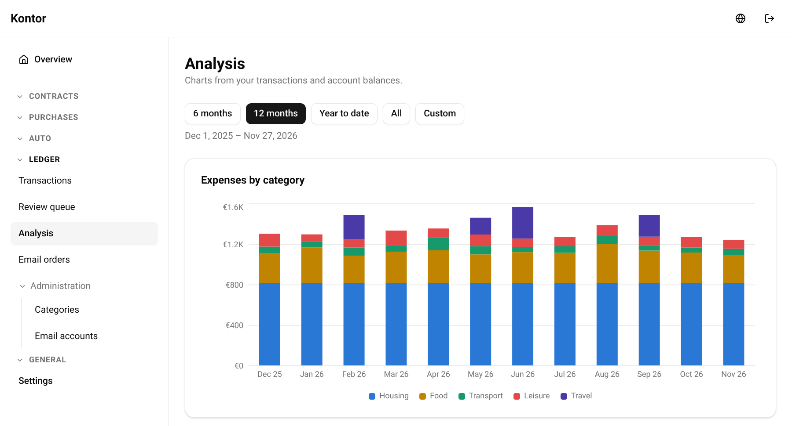

# Kontor

Kontor is a self-hosted personal finance manager that connects bank transactions with the contracts, purchases, and vehicles behind them.

Import a bank statement and Kontor can spot a recurring payment, such as a monthly internet bill. It proposes a contract in your inbox. Accept it, and the contract links back to the payments that revealed it. The whole workflow runs without an LLM.



## What you can track

| Module | What it helps you do |
| --- | --- |
| Contracts | Track subscriptions, see when your notice period ends, and get renewal reminders by email. |
| Purchases | Keep the item, price, seller, and invoice together, linked to the bank payment. |
| Vehicles | Log fuel, repairs, and insurance to see what each vehicle costs over time. |
| Ledger | Import bank transactions, review spending by category, and chart cash flow and net worth across accounts. |

Use any combination of modules. [Optional integrations](docs/integrations.md) add bank sync, document links, and receipt or email extraction.

## How it’s built

A single Go service serves the React and TypeScript frontend and stores data in embedded BadgerDB. Each module owns its routes and storage. A [shared link registry](backend/internal/storage/link/) lets the ledger link a payment to a repair: both records are updated in one database transaction, without the ledger and vehicle modules importing each other.

## Run locally

From a fresh checkout with Docker Compose installed, create a signing key once and start Kontor:

```sh
(umask 077; printf 'JWT_SECRET=%s\n' "$(openssl rand -hex 32)" > .env)
docker compose up -d
```

Open <http://localhost:8080> and create your account. Registration closes after the first sign-up by default. For live reload, follow the [development setup](docs/development.md) and run `task dev`.

## Documentation

[Self-hosting and backups](docs/self-hosting.md) · [Integration guides](docs/integrations.md) · [REST API reference](docs/api.md) · [MCP for agents](docs/mcp.md)

[MIT license](LICENSE). Developed with assistance from AI tools.
